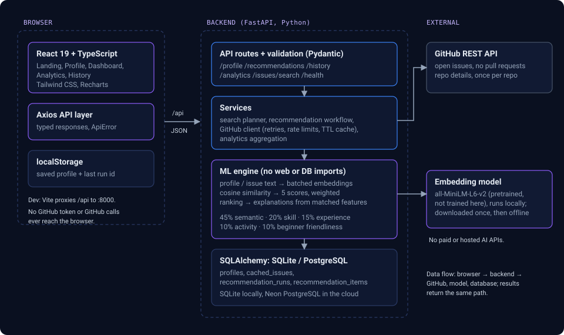
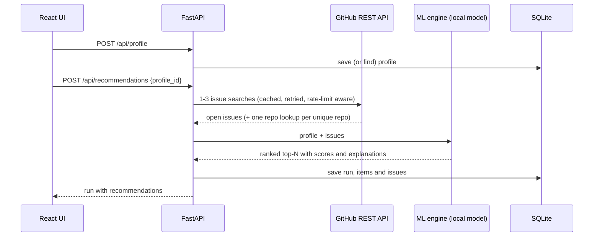

# ContribMatch

**An open-source contribution recommender.** ContribMatch searches real, open GitHub issues and ranks them against a developer's skills,
experience level, preferred domains and learning interests, using a pretrained embedding model that runs locally plus a transparent,
hand-designed scoring formula. Every recommendation comes with its five component scores and an explanation built only from features that were actually found.

> **Project status (read this first).** Backend, frontend and evaluation framework are implemented and tested. The semantic and hybrid
> rankings have **not yet been measured**: the pretrained model could not be downloaded in the environment where this was built, so only the keyword baseline
> has real benchmark numbers (see [Evaluation](#evaluation)). The web UI has been tested with automated tests and a production build but has **not been viewed in a real browser**,
> and there are no screenshots yet. The real `sentence-transformers` integration has likewise only been tested against a stand-in.
>
> **Cloud deployment (Neon + Render + Vercel) is prepared but has never been deployed**, and the code has not been run against a live PostgreSQL database. See [Deployment](#deployment) and [`docs/DEPLOYMENT.md`](docs/DEPLOYMENT.md).

## Contents
1. [Problem statement](#problem-statement) · 2. [Features](#features) · 3. [Technology stack](#technology-stack) · 4. [Architecture](#architecture) · 5. [Folder structure](#folder-structure) ·
6. [ML methodology](#ml-methodology) · 7. [Scoring formula](#scoring-formula) · 8. [Evaluation](#evaluation) · 9. [Installation](#installation) · 10. [Environment configuration](#environment-configuration) ·
11. [Running the application](#running-the-application) · [Deployment](#deployment) · 12. [API documentation](#api-documentation) · 13. [Testing](#testing) · 14. [Security notes](#security-notes) · 15. [Limitations](#limitations) · 16. [Future improvements](#future-improvements)

## Problem statement
Finding a first (or next) open-source contribution is harder than it looks. GitHub's issue search is keyword-based, label conventions differ from project to project,
and nothing tells a newcomer how hard an issue really is or whether it fits their stack and interests. ContribMatch narrows the gap by combining real issue discovery
with a ranking that considers meaning (not just matching words), the developer's level, and how active and approachable the project looks, and by showing *why* each issue was suggested.

## Features
- **Developer profile**: skills, preferred languages, domains, things to learn, and experience level (validated and saved; identical profiles are de-duplicated).
- **Real GitHub discovery**: open issues only (pull requests excluded, unassigned by default), language/label/keyword filters, retries, rate-limit handling, caching, stale-cache fallback.
- **Hybrid ranking**: semantic similarity (45%), skill compatibility (20%), experience fit (15%), repository activity (10%), beginner friendliness (10%), each 0-100.
- **Explanations**: matched skills, relevant labels, why the issue matched, and technologies mentioned in the issue that you could learn. Nothing is generated freely.
- **Dashboard**: top-N recommendations (default 10), client-side filtering and sorting, expandable score breakdown, direct links to the original issues.
- **History and analytics**: every run is stored in SQLite; analytics (totals, score and skill-match distributions, domains, languages, labels) are computed from that history.
- **Evaluation framework**: 20 profiles, 240 judged real issues, P@5 / Recall@5 / nDCG@5 / MRR with bootstrap confidence intervals, fully reproducible.
- **No paid or hosted AI APIs.** The embedding model runs on your machine.

## Technology stack
| Layer | Technology |
|---|---|
| Backend | Python 3.11+ (test suite run on 3.11.18 and 3.12.3), FastAPI, Uvicorn, Pydantic v2 + pydantic-settings, HTTPX (async), SQLAlchemy 2, python-dotenv; SQLite for local development, PostgreSQL via psycopg 3 for the cloud |
| ML | sentence-transformers (`sentence-transformers/all-MiniLM-L6-v2`, pretrained), scikit-learn (cosine similarity), NumPy, pandas |
| Frontend | React 19, TypeScript 6, Vite 8, Tailwind CSS 4, React Router 7, Axios, Recharts 3, Lucide React |
| Tests | pytest 9 (backend), Vitest + Testing Library + jsdom (frontend) |
| Deployment targets (prepared, not yet deployed) | Neon PostgreSQL (database), Render (API), Vercel (frontend) |

Frontend versions above are those it was built and tested with (Node 22.23, npm 10.9). The backend suite was run on both Python 3.11.18 and 3.12.3, **without PyTorch / sentence-transformers installed** (see [Testing](#testing)).

## Architecture


The browser talks only to the FastAPI backend (in development through the Vite `/api` proxy). The backend talks to GitHub, runs the local model and stores results.
Routes only handle HTTP; `services/` orchestrate I/O; `ml/` is pure logic with **no web or database imports** (enforced by a test).



## Folder structure
```
ContribMatch/
├── backend/
│   ├── app/
│   │   ├── api/  # FastAPI routes + dependencies
│   │   │   ├── routes/
│   │   │   ├── deps.py
│   │   │   └── router.py
│   │   ├── core/  # settings, error handling, logging
│   │   │   ├── config.py
│   │   │   ├── exceptions.py
│   │   │   └── logging.py
│   │   ├── db/  # SQLAlchemy engine, session, UTC datetime type
│   │   │   ├── base.py
│   │   │   ├── session.py
│   │   │   └── types.py
│   │   ├── ml/  # recommendation engine (no web/DB imports)
│   │   │   ├── baseline.py
│   │   │   ├── compare.py
│   │   │   ├── embedder.py
│   │   │   ├── engine.py
│   │   │   ├── explain.py
│   │   │   ├── profile.py
│   │   │   ├── scoring.py
│   │   │   ├── terms.py
│   │   │   ├── text_builder.py
│   │   │   └── types.py
│   │   ├── models/  # ORM tables
│   │   │   ├── issue.py
│   │   │   ├── profile.py
│   │   │   └── recommendation.py
│   │   ├── schemas/  # Pydantic request/response models
│   │   │   ├── analytics.py
│   │   │   ├── health.py
│   │   │   ├── issues.py
│   │   │   ├── profile.py
│   │   │   └── recommendations.py
│   │   ├── services/  # GitHub client, search planner, workflow, analytics
│   │   │   ├── analytics_service.py
│   │   │   ├── github_client.py
│   │   │   ├── profile_service.py
│   │   │   ├── recommendation_service.py
│   │   │   └── search_plan.py
│   │   └── main.py
│   ├── data/
│   ├── evaluation/  # benchmark: data, labels, metrics, results
│   │   ├── data/
│   │   ├── results/
│   │   ├── README.md
│   │   ├── collect_candidates.py
│   │   ├── evaluate.py
│   │   ├── evaluation_queries.csv
│   │   ├── metrics.py
│   │   └── relevance_judgments.csv
│   ├── tests/  # backend test suite
│   │   ├── conftest.py
│   │   ├── github_mock.py
│   │   ├── ml_doubles.py
│   │   ├── test_api_integration.py
│   │   ├── test_config.py
│   │   ├── test_errors_and_cors.py
│   │   ├── test_evaluation.py
│   │   ├── test_github_search.py
│   │   ├── test_health.py
│   │   ├── test_issue_params.py
│   │   ├── test_ml_compare.py
│   │   ├── test_ml_embedder.py
│   │   ├── test_ml_engine.py
│   │   ├── test_ml_profile_text.py
│   │   ├── test_ml_scoring.py
│   │   └── test_search_plan.py
│   ├── .env.example
│   ├── README.md
│   ├── pytest.ini
│   ├── requirements-dev.txt
│   └── requirements.txt
├── docs/  # architecture diagram
│   └── architecture.svg
├── frontend/
│   ├── public/
│   ├── src/
│   │   ├── api/  # Axios client + endpoint functions
│   │   │   ├── client.ts
│   │   │   └── endpoints.ts
│   │   ├── assets/
│   │   ├── components/  # UI components
│   │   │   ├── AnalyticsCharts.tsx
│   │   │   ├── ApiStatus.tsx
│   │   │   ├── AppShell.tsx
│   │   │   ├── EmptyState.tsx
│   │   │   ├── ErrorState.tsx
│   │   │   ├── FilterPanel.tsx
│   │   │   ├── LoadingState.tsx
│   │   │   ├── Logo.tsx
│   │   │   ├── Navbar.tsx
│   │   │   ├── ProfileForm.tsx
│   │   │   ├── RecommendationCard.tsx
│   │   │   ├── ScoreBreakdown.tsx
│   │   │   ├── ScoreRing.tsx
│   │   │   ├── Sidebar.tsx
│   │   │   └── SkillSelector.tsx
│   │   ├── context/
│   │   │   ├── SessionProvider.tsx
│   │   │   └── sessionContext.ts
│   │   ├── hooks/
│   │   │   └── useResource.ts
│   │   ├── lib/  # filters, formatting, safe-link helper
│   │   │   ├── errors.ts
│   │   │   ├── filters.ts
│   │   │   ├── format.ts
│   │   │   ├── profile.ts
│   │   │   └── suggestions.ts
│   │   ├── pages/  # route pages
│   │   │   ├── Analytics.tsx
│   │   │   ├── Dashboard.tsx
│   │   │   ├── History.tsx
│   │   │   ├── Landing.tsx
│   │   │   ├── NotFound.tsx
│   │   │   └── ProfileSetup.tsx
│   │   ├── test/  # frontend tests + backend-generated fixtures
│   │   │   ├── fixtures/
│   │   │   ├── components.test.tsx
│   │   │   ├── contract.test.ts
│   │   │   ├── helpers.tsx
│   │   │   ├── lib.test.ts
│   │   │   ├── pages.test.tsx
│   │   │   └── setup.ts
│   │   ├── types/
│   │   │   └── api.ts
│   │   ├── App.tsx
│   │   ├── index.css
│   │   └── main.tsx
│   ├── .env.example
│   ├── .gitignore
│   ├── README.md
│   ├── eslint.config.js
│   ├── index.html
│   ├── package-lock.json
│   ├── package.json
│   ├── tsconfig.app.json
│   ├── tsconfig.json
│   ├── tsconfig.node.json
│   └── vite.config.ts
├── .gitignore
├── LICENSE
└── README.md
```

## ML methodology
**What is pretrained and what is ours.** The embedding model `sentence-transformers/all-MiniLM-L6-v2` is a pretrained third-party model used as-is: it is **not trained or fine-tuned here**.
Everything else (text construction, the five scores, the weights, the explanations) is our own hand-designed algorithm. Its weights and thresholds are **initial design choices, not learned parameters**.

1. **Text.** A profile becomes text from its skills, languages, domains and learning interests. Experience level is deliberately *not* embedded (it has its own score). An issue becomes text from its title, labels, repository language and description, then its cleaned body (HTML comments, code blocks, images and URLs removed; truncated to 1000 characters). Missing fields are simply omitted, never replaced with placeholder text.
2. **Embeddings.** One batched call embeds the profile and all candidate issues. The model loads once per process, vectors are L2-normalised and cached by text hash, so unchanged issues are never re-encoded.
3. **Similarity.** Cosine similarity (scikit-learn), mapped linearly to 0-100 (cosine <= 0.10 gives 0, >= 0.60 gives 100). These two cut-offs are design constants chosen from typical ranges for this model class and **have not been validated on real model output yet**.
4. **Estimates, not facts.** GitHub does not say how hard an issue is. Experience fit and beginner friendliness are *estimated* from labels (for example `good first issue`, `advanced`), description length and comment count, and the evidence used is returned with each recommendation. With no evidence, experience fit is a neutral 50.
5. **Explanations** are assembled from detected facts only (skills found in the text, labels present, dates, the semantic score). If nothing matched, the explanation says that the match relies on semantic similarity. "Skills you could learn" lists your stated learning interests found in the issue, then other known technologies literally mentioned in it that you did not list.

Known limits: term matching is lexical (no stemming); very ambiguous names (`go`, `r`, `c`) only match through the repository's primary language or an alias such as `golang`; the technology vocabulary is a fixed list of 76 terms.

## Scoring formula
`Final = 0.45 × Semantic + 0.20 × Skill + 0.15 × Experience + 0.10 × Activity + 0.10 × Beginner` (each component 0-100)

| Component | Weight | Definition |
|---|---|---|
| Semantic similarity | 45% | calibrated cosine similarity between profile and issue embeddings |
| Skill compatibility | 20% | skills and languages found in the issue as whole words; title, labels or repo language count 1.0, description only 0.6; `100 × min(1, sum / min(#terms, 3))` |
| Experience compatibility | 15% | estimated issue difficulty vs. the developer's level (too hard is penalised more than too easy) |
| Repository activity | 10% | recency of the last repository push (50%) and issue update (35%) with a 45-day half-life, plus stars on a log scale (15%); missing parts are dropped and weights renormalised |
| Beginner friendliness | 10% | base 30; +45 beginner label; +10 `help wanted`; +10 substantive description; -10 empty description or long discussion; -25 `advanced`/`hard` label |

## Evaluation
**Method.** 20 synthetic developer personas (20 queries; 7 beginner, 9 intermediate, 4 advanced; 12 domains) each have 12 candidate issues (240 judged rows), taken from real GitHub issues
collected on 2026-11-22 by three pooled searches ranked by GitHub's own order (specific, broad and distractor). Each candidate has a relevance label 0 (not relevant), 1 (partially) or 2 (highly), with a one-line rationale.
Three systems rank the **same** candidates: a keyword baseline, semantic similarity only, and the full hybrid score. Rankers never see the labels. Metrics: Precision@5, Recall@5, nDCG@5 (graded) and MRR,
with *lenient* (label >= 1) and *strict* (label 2) relevance, 95% bootstrap confidence intervals over queries, fixed seeds. Details, rubric and limitations: [`backend/evaluation/README.md`](backend/evaluation/README.md).

**Labels.** All labels were assigned by one annotator, **the AI assistant that built this project**, from the issue title, labels and the start of the description. They are not independent human judgments and have no inter-annotator agreement.
Label counts (0 / 1 / 2): 61 / 87 / 92.

**Actual results** (mean over 20 queries, [95% CI]; `results/RESULTS.md` is the generated source):

| System | nDCG@5 | P@5 strict | Recall@5 strict | MRR strict | P@5 lenient | Recall@5 lenient | MRR lenient |
|---|---|---|---|---|---|---|---|
| Keyword baseline | 0.78 [0.71, 0.85] | 0.61 [0.50, 0.71] | 0.69 [0.60, 0.77] | 0.79 [0.66, 0.90] | 0.93 [0.86, 0.98] | 0.52 [0.49, 0.55] | 0.95 [0.88, 1.00] |
| Semantic similarity only | **not run** | | | | | | |
| Hybrid (full score) | **not run** | | | | | | |
| *Random order (expected)* | 0.54 [0.52, 0.58] | 0.38 [0.32, 0.44] | 0.41 [0.41, 0.42] | 0.59 [0.53, 0.65] | 0.75 [0.70, 0.79] | 0.42 [0.42, 0.42] | 0.86 [0.83, 0.89] |
| *Perfect order (upper bound)* | 1.00 | 0.83 [0.71, 0.93] | 0.94 [0.88, 0.98] | 1.00 | 1.00 | 0.57 [0.53, 0.61] | 1.00 |

- **Semantic and hybrid have no results yet.** They need the model download; run `python evaluation/evaluate.py` on a machine with internet access. No numbers for them are claimed anywhere in this project.
- The keyword baseline clearly beats random order on nDCG@5 and strict precision, but **lenient metrics sit near their ceilings** (random lenient P@5 is already 0.75; lenient Recall@5 cannot exceed 0.57 because every query has 6-10 relevant candidates for 5 slots). Prefer nDCG@5 and the strict columns.
- The benchmark likely **favours lexical matching**: candidates came from keyword/language searches and labels were judged from visible text, both of which reward literal overlap. It can understate a semantic method.
- n = 20 queries, so confidence intervals are wide. Hybrid will also be evaluated *without* repository metadata (not collected), which weakens its activity and language-match signals compared with production.

## Installation
Prerequisites: Python 3.11+, Node.js 22.12+ (Vite 8 alone needs 20.19+, but the Vitest test runner needs 22.12+; 22.23 was used) and npm, Git. Internet access is needed once to download the embedding model (~90 MB) on first use.

```bash
git clone <your-repository-url> ContribMatch && cd ContribMatch

# Backend
cd backend
python -m venv .venv
source .venv/bin/activate            # Windows PowerShell: .venv\Scripts\Activate.ps1
pip install -r requirements-dev.txt  # runtime + test tools (use requirements.txt for runtime only)
cp .env.example .env                 # Windows: copy .env.example .env

# Frontend (second terminal)
cd frontend
npm install
```
On a CPU-only machine, install PyTorch's CPU build first to avoid the large CUDA download: `pip install torch --index-url https://download.pytorch.org/whl/cpu`, then the requirements.

## Environment configuration
Backend settings live in `backend/.env` (copied from `backend/.env.example`, which documents every variable; `.env` is git-ignored and must never be committed).

| Variable | Default | Purpose |
|---|---|---|
| `GITHUB_TOKEN` | empty | Optional but strongly recommended. A GitHub personal access token for **public data (no scopes needed)** raises GitHub's limits (search 10 to 30 requests/min, core API 60 to 5000/hour). Backend only; never sent to the browser. |
| `CORS_ORIGINS` | `http://localhost:5173,http://127.0.0.1:5173` | Allowed frontend origins |
| `DATABASE_URL` | `sqlite:///./data/contribmatch.db` | SQLite file for local development (relative paths resolve from `backend/`). In the cloud, a Neon `postgresql://…` connection string (**secret**); the app switches to its psycopg 3 driver automatically. Tables are created automatically |
| `CORS_ORIGIN_REGEX` | empty | Optional regex for origins you cannot list (for example Vercel preview URLs) |
| `MODEL_CACHE_DIR` | empty | Where model files are cached on disk (the Render build downloads the model here) |
| `EMBEDDING_MODEL` | `sentence-transformers/all-MiniLM-L6-v2` | Pretrained model name |
| `PRELOAD_MODEL` | `false` | Load the model at startup instead of on the first recommendation request |
| `MAX_SEARCH_QUERIES`, `CANDIDATES_PER_QUERY` | `3`, `30` | GitHub searches per request, issues per search |
| `DB_POOL_*`, `DB_CONNECT_TIMEOUT_SECONDS` | see file | PostgreSQL connection pool and timeouts (ignored for SQLite) |
| `GITHUB_*` timeouts, retries, cache TTLs | see file | HTTP behaviour and caching |

Without a token the app still works, but repository details (language, description, stars) can run out after 60 lookups per hour and are then reported as warnings. The frontend needs no configuration locally; `VITE_API_BASE_URL` (the deployed backend URL) is only needed for a deployed build (see `frontend/.env.example`). It is public, so never put a secret in any `VITE_*` variable (the build refuses to).

## Running the application
```bash
# terminal 1
cd backend && source .venv/bin/activate
uvicorn app.main:app --reload --port 8000        # interactive API docs: http://localhost:8000/docs

# terminal 2
cd frontend
npm run dev                                       # http://localhost:5173 (proxies /api to port 8000)
```
Open http://localhost:5173, create a profile, and the dashboard generates your recommendations. **The first recommendation request is slow**: it searches GitHub and downloads and loads the model once (set `PRELOAD_MODEL=true` to load at startup).
For a production-style frontend build use `npm run build` (output in `frontend/dist`). There is no Docker or CI setup; hosting configuration for Render and Vercel is described next.

## Deployment
The repository is prepared for **Neon PostgreSQL + Render (API) + Vercel (frontend)**. Nothing has been deployed or run against a live PostgreSQL database; the complete, ordered guide with every dashboard setting is in **[`docs/DEPLOYMENT.md`](docs/DEPLOYMENT.md)**.

| What | File |
|---|---|
| Render service definition (secrets are prompted for, never stored) | [`render.yaml`](render.yaml) |
| Python version | `backend/.python-version` and `PYTHON_VERSION` in `render.yaml` (3.12.3) |
| Model pre-download at build time (loading into memory stays lazy) | `backend/scripts/prefetch_model.py` |
| Vercel build and SPA routing | `frontend/vercel.json` |

Render build command: `pip install --upgrade pip && pip install torch --index-url https://download.pytorch.org/whl/cpu && pip install -r requirements.txt && python scripts/prefetch_model.py`
Render start command: `uvicorn app.main:app --host 0.0.0.0 --port $PORT --proxy-headers --forwarded-allow-ips "*"` (health check path `/api/health/live`, which does not touch the database).

**Read the risks in the guide before making the URL public.** In short: PyTorch plus the model very likely needs more than Render's 512 MB instances (2 GB is configured, unmeasured); the API has no authentication or rate limiting; and `/api/history` and `/api/analytics` expose every visitor's data.

## API documentation
Base path `/api`. Interactive documentation is served at `/docs` (OpenAPI at `/openapi.json`).

| Method | Path | Description | Success |
|---|---|---|---|
| GET | `/api/health/live` | liveness only: never touches the database (used by Render's health check) | 200 |
| GET | `/api/health` | readiness: also checks the database | 200 |
| POST | `/api/profile` | validate and save a profile; identical content returns the existing one | 201 new, 200 existing |
| POST | `/api/recommendations` | body `{"profile_id": 1}` **or** `{"profile": {...}}`, optional `top_k` (1-20, default 10) and `labels`; discovers, ranks, explains and stores | 201 |
| GET | `/api/recommendations/{id}` | a stored run | 200 |
| GET | `/api/history?limit=&offset=` | past runs, newest first (limit 1-100) | 200 |
| GET | `/api/analytics` | aggregates computed from stored history | 200 |
| GET | `/api/issues/search` | raw GitHub search: `language`, `labels`, `domain`, `q`, `sort`, `per_page`, `page`, `unassigned` | 200 |

**Errors** share one shape: `{"error": {"code": "...", "message": "...", "details": ...}}`. Codes: 404 `not_found`, 422 `validation_error` / `unprocessable` (including an empty profile), 429 `rate_limited` (with `Retry-After`),
502 `external_service_error`, 503 `service_unavailable` (GitHub down, or the model could not be loaded) or `database_unavailable` (database unreachable; with `Retry-After`), 504 `upstream_timeout`, 500 `internal_error` (details hidden).

**Profile body**
```json
{"skills": ["Python", "FastAPI"], "learning_interests": ["Rust"], "experience_level": "beginner",
 "domains": ["web development"], "preferred_languages": ["Python"]}
```
The first two languages and the first domain shape the GitHub search; the experience level picks the issue labels searched.

**Response shape of `POST /api/recommendations`** (real output of the code, produced in the test suite with a fake GitHub transport and a stand-in embedding model, so the *values* are illustrative only):
```json
{
  "id": 1,
  "profile_id": 1,
  "issues_analyzed": 4,
  "top_k": 10,
  "model": "<embedding model name>",
  "weights": {
    "semantic": 0.45,
    "skill": 0.2,
    "experience": 0.15,
    "activity": 0.1,
    "beginner": 0.1
  },
  "search_queries": [
    "is:issue is:open \u2026"
  ],
  "warnings": [],
  "stale_data": false,
  "recommendations": [
    {
      "rank": 1,
      "issue": {
        "title": "Add PyTorch dataloader tests",
        "url": "https://github.com/octo/alpha/issues/1",
        "state": "open",
        "labels": [
          "good first issue",
          "machine-learning"
        ],
        "comments": 1,
        "created_at": "2026-01-01T00:00:00Z",
        "updated_at": "2026-02-01T00:00:00Z",
        "repo_full_name": "octo/alpha",
        "repo_language": "Python",
        "body": "\u2026"
      },
      "scores": {
        "overall": 88.4,
        "semantic_similarity": 100.0,
        "skill_compatibility": 100.0,
        "experience_compatibility": 100.0,
        "repository_activity": 8.8,
        "beginner_friendliness": 75.0
      },
      "cosine_similarity": 0.9714,
      "matching_skills": [
        "Python",
        "PyTorch"
      ],
      "relevant_labels": [
        "good first issue",
        "machine-learning"
      ],
      "explanation": "Mentions your skills: Python, PyTorch. The repository's main language is Python, one of your preferred languages. Relates to your preferred domain: machine learning. Labelled 'good first issue', a beginner-friendly signal, which fits your beginner level. The repository was last pushed to 284 day(s) ago; the issue was updated 293 day(s) ago. Semantic similarity to your profile: 100/100 (strong).",
      "potential_skills_to_learn": [],
      "difficulty_signals": [
        "label 'good first issue' (beginner signal)"
      ]
    },
    "\u2026"
  ]
}
```

## Testing
| Suite | Command | Result |
|---|---|---|
| Backend (pytest) | `cd backend && pytest` | **182 passed** at the previous hand-off. Deployment preparation then added tests (PostgreSQL schema/query compilation, database-failure handling, deployment-file checks); only the affected test files were run afterwards (**69 + 78 passed**), **not the full suite**, so please run `pytest` for current totals |
| Frontend (Vitest) | `cd frontend && npm test` | **48 passed** at the previous hand-off, plus 6 new tests for the API base URL logic; type-check, lint, production build and the build-time secret guard were re-checked, the full test run was not repeated |
| Dependency audit | `npm audit`, `pip-audit -r requirements-dev.txt` | clean at the previous hand-off; **not re-run** after adding `psycopg[binary]` |

Backend tests (both Python versions) cover validation, error handling, CORS, GitHub client behaviour (mocked), scoring, explanations, the recommendation workflow, persistence, analytics and the evaluation code. They use a fake GitHub transport and a **stand-in embedding model**, so they verify logic and plumbing, **not the quality of the real model's rankings**.
Frontend tests mock the API module and use JSON fixtures generated by the real backend code. No test depends on the network.

## Security notes
- The GitHub token is read only from the backend environment, sent only in the outgoing GitHub request header, and never returned by any endpoint or logged. The frontend never contacts GitHub; a source and bundle scan found no token or GitHub API calls.
- `.env` files are git-ignored (`.env.example` files are tracked and contain no secrets); a secret scan of the project found nothing.
- Issue titles are rendered as text and links are only created for `https://github.com/...` URLs. User-supplied search text is stripped of characters that could inject GitHub search qualifiers.
- CORS is limited to configured origins and the GET/POST/OPTIONS methods. Origins from `CORS_ORIGINS` are exact (trailing slashes tolerated); the optional `CORS_ORIGIN_REGEX` is off by default.
- `DATABASE_URL` and `GITHUB_TOKEN` are secrets: settings errors never echo their values, database errors are logged by type only, and the Render Blueprint takes them from the dashboard (`sync: false`) rather than the repository.
- The frontend build fails if any `VITE_*` variable name or value looks like a secret (those are embedded in the public bundle).
- **There is no authentication and no rate limiting on this API**: it is designed for local or trusted use. Profiles and history are shared by anyone who can reach the backend.

## Limitations
- **Not yet measured:** semantic and hybrid ranking quality (benchmark pending model download); calibration constants for cosine similarity are unvalidated.
- **Benchmark caveats:** small (20 queries), single AI annotator, lexical-friendly construction, no repository metadata in the snapshot (see Evaluation).
- **Estimates:** difficulty and beginner friendliness are heuristics from labels, length and comments. Many repositories use non-standard labels, which these rules will not recognise.
- **GitHub limits:** without a token, repository details are often missing; GitHub search returns at most 1000 results and covers only what its index exposes.
- **Matching is lexical for skills** (no stemming, fixed technology vocabulary); non-English issues are poorly handled by the English-centred checks.
- **Single user model:** no accounts; the saved profile and last run id live in the browser's localStorage, history is global to the database.
- **No migrations:** tables are created with `create_all`; after a model change in development delete `backend/data/*.db`. Stored runs show issues as last cached.
- **Frontend:** not viewed in a real browser or on real devices; no end-to-end browser tests; hover explanations use `title` attributes, which do not show on touch screens.
- **Operations:** no Docker or CI. Render/Vercel/Neon configuration exists but **has never been deployed**, and the code has not run against a live PostgreSQL database (PostgreSQL support is checked statically and by compiling SQL for that dialect). Model memory use on Render is unmeasured.
- **Public deployment:** no authentication or rate limiting, and history/analytics are shared by all visitors (see `docs/DEPLOYMENT.md`).
- **Real model path unexercised:** the actual `SentenceTransformer` load and `encode` calls have only been run against a fake module in tests (the model could not be downloaded where this was built). The first real run is the first end-to-end test of that integration; if something fails there, `POST /api/recommendations` returns a clear 503.

## Future improvements
- Run and publish the semantic and hybrid evaluation; re-collect candidates with repository metadata and add independent human labels with agreement statistics.
- Tune weights and calibration on held-out data, and compare against stronger lexical baselines (for example BM25).
- Learn from user feedback (saved, dismissed and completed issues) to personalise rankings.
- Use GitHub's GraphQL API to reduce calls, and add background refresh of cached issues.
- Accounts, per-user history, Alembic migrations, API rate limiting.
- Docker setup and CI, end-to-end browser tests, accessibility audit and real-device layout checks.

## License
MIT, see [LICENSE](LICENSE).
